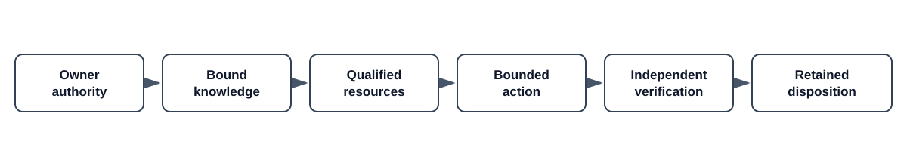

# Research

This repository is the public home for research publications by Anthony
Mackulin. It currently contains one publication, focused on the Home Artificial
Intelligence Platform (HAIP). Additional research can be indexed here as it is
prepared for publication.

## Current publication

### Home Artificial Intelligence Platform (HAIP)

**Full paper:** [**What HAIP Is and Why Whole-System Comprehension Is the
Research Object**](paper/what-haip-is.md)

The linked manuscript is the complete research paper, not an abstract or short
project description. It contains the full argument, system model, bounded
evidence, comprehension case, relationship to existing systems, limitations,
and references. The material below is the repository overview.

**Research publication preview 0.1**

**Anthony Mackulin**

> **Pre-release research material.** This repository preview describes selected
> HAIP research. It is not a software release, product announcement,
> installation package, or invitation to download or operate HAIP.

## Publication overview

The Home Artificial Intelligence Platform (HAIP) is an owner-operated local AI
engineering system and research environment. It treats authority, resource
validity, knowledge state, execution, failure, and recovery as one connected
evidence problem.

HAIP asks two linked questions:

1. What evidence is required before the owner can responsibly admit, retain, or
   recover a local AI-assisted result?
2. Can an AI system preserve the relationships that answer that question, rather
   than reducing HAIP to a list of component concepts?

The six layers are:

- owner authority;
- bound knowledge;
- qualified resources;
- bounded action;
- independent verification; and
- retained disposition.

A favorable result at the end of the chain cannot repair an invalid condition
earlier in it. A passed test cannot repair stale authorization. A citation
cannot grant permission. A guest pass cannot erase a trusted host failure. A
recovered record cannot silently authorize replay.

## Inside the full paper

The paper describes:

- HAIP's public and internal working names;
- the six connected evidence layers;
- the action lifecycle from proposal to retained disposition;
- how local resource, retrieval, verification, failure, and recovery evidence
  constrain one another;
- a bounded observation that component recall did not guarantee whole-system
  comprehension; and
- the limits of the current evidence.

The accompanying [evidence and claim boundaries](EVIDENCE-AND-CLAIMS.md)
identify what supports each public claim, what remains private, and what this
release does not establish.

Citation guidance is provided in [CITATION.md](CITATION.md).

## Evidence scope

This preview draws on four completed, bounded research areas:

- local inference and resource qualification;
- revision-specific local knowledge retrieval and recovery;
- a bounded repository workflow with isolated guest verification; and
- comparative evaluation contracts with finite attempts and retained failure
  evidence.

The current record is a private, single-environment case study with limited task
coverage and some synthetic fixtures. It does not establish general autonomous
coding ability, production security, independent certification, or universal
applicability.

## Publication boundary

This preview intentionally excludes proprietary source, private operational
records, credentials, device identities, network details, home-infrastructure
topology, and instructions for deploying HAIP.

Copyright © 2026 Anthony Mackulin. All rights reserved. No public reuse license
or patent license is granted. See [RIGHTS.md](RIGHTS.md) for the exact boundary.
This publication is publicly available in `MackuliN/Research`. Pre-release
`research-v0.1` records the owner-approved 14-file research payload.

## Publication status

- Manuscript: public research pre-release 0.1
- Evidence: public claim-boundary note included; underlying private records are
  not distributed
- Figures: code-authored SVG; static validation passed, and both diagrams were
  inspected in GitHub's native rendering without the previously reported stray
  diagram text
- Sterilization: the exact released payload and its staging history were
  reviewed before publication
- Publication: public GitHub pre-release `research-v0.1`
