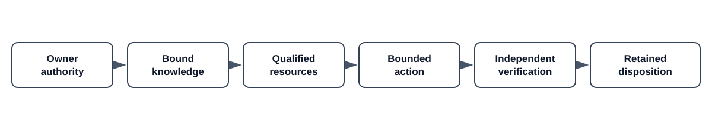
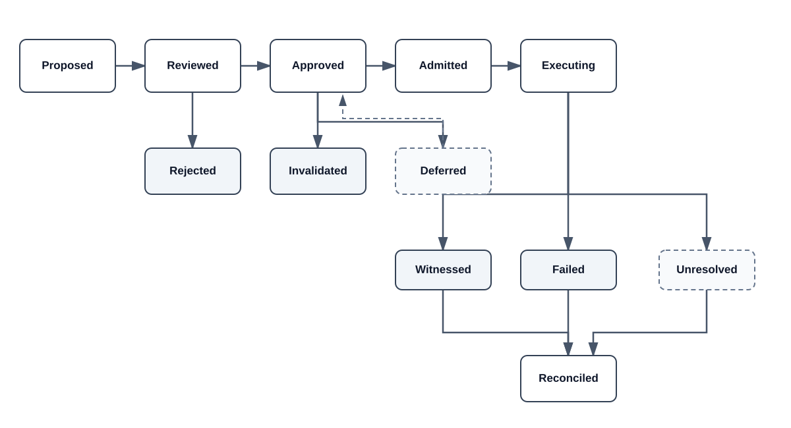

# Home Artificial Intelligence Platform (HAIP)

## What it is and why whole-system comprehension is the research object

*Anthony Mackulin · Research pre-release 0.1 · November 2026 · Public-review candidate*

## Abstract

The Home Artificial Intelligence Platform (HAIP) is an owner-operated local AI
engineering system. It connects the conditions surrounding AI-assisted work:
who authorized it, which source and knowledge informed it, whether the evaluated
runtime and resources were available, what exact action was admitted, how its
effects were checked, what failed, and what may be recovered afterward.

HAIP is not a model, a single coding agent, a benchmark, or a downloadable
product. It is an operating structure for deciding when bounded local AI work
may begin and what evidence is required before its result can be retained. The
system treats authorization, resource validity, knowledge state, execution,
failure, and recovery as one connected evidence problem. It is also a research
environment for testing whether an AI system can preserve and act within those
relationships instead of merely recalling the component concepts.

This paper describes that whole. It explains six connected layers—owner
authority, bound knowledge, qualified resources, bounded action, independent
verification, and retained disposition—and shows why a valid result at one
layer cannot repair invalid evidence at another. The supporting cases are
deliberately bounded. They document how source drift, thermal limits, stale
retrieval evidence, disagreement between static and guest checks, and
interruption changed what the owner could responsibly admit, retain, or
recover. A further observed case shows that a capable language model with access
to the component descriptions can still reduce HAIP to those components and
fail to preserve what the integrated system does. The paper does not claim
architectural priority, autonomous general coding competence, production
security, or universal applicability.

## 1. Name and scope

**Home Artificial Intelligence Platform** is HAIP's public-facing name. The
project originated and continues internally under the working name **Home AI
Infrastructure Project**. Both names use the acronym **HAIP**.

This publication describes selected research methods and bounded results. It
does not release HAIP as a product, provide an installation package, disclose
its proprietary implementation, or grant access to private operational
evidence or home infrastructure.

HAIP is owner-operated. “Owner” is not a generic administrator role in this
paper. It identifies the person whose projects, equipment, permissions, and
risk decisions define the system's authority boundary. Models, retrieved text,
generated tests, workflow records, and recovered evidence may inform that
boundary, but none can enlarge it by itself.

## 2. What HAIP is

HAIP is an **evidence-integrated local AI engineering system**. Its unit of
concern is not merely a model response. It is the complete disposition of a
bounded action: proposed, reviewed, authorized, admitted, executed, witnessed,
failed, deferred, cancelled, or left explicitly unresolved.

The platform is therefore both an operating structure and a research
instrument. It tests whether models and agent workflows can remain faithful to
the whole evidence contract while planning, explaining, acting, evaluating, and
recovering. Fluency about the individual controls is insufficient if the model
loses the rules connecting them.

The system asks six connected questions:

1. **Was this exact work authorized?**
2. **What source and knowledge informed it, and were they current enough?**
3. **Could the evaluated runtime and resource profile validly perform it now?**
4. **What exact action, scope, worker, and finite attempt were admitted?**
5. **What actually happened, and which independent checks passed or failed?**
6. **What may now be claimed, retained, retried, or recovered?**

HAIP calls an action **evidence-closed** when its record connects the owner's
decision to a bounded disposition without depending on an unverified success
statement. Closure does not mean success. A failed, cancelled, deferred, or
unresolved action can be evidence-closed if its actual disposition and claim
limits are preserved accurately.

This creates two linked research questions:

1. What evidence is required before the owner can responsibly admit, retain, or
   recover a local AI-assisted result?
2. Can an AI system follow the cross-layer relationships that answer that
   question, rather than reducing HAIP to a list of components?

## 3. The six connected layers

| Layer | Function | Evidence boundary |
| --- | --- | --- |
| Owner authority | Defines exact scope, decision, and invalidation conditions | Approval does not prove admission, execution, or effect |
| Bound knowledge | Identifies indexed revisions, passages, staleness, and conflict | A citation can support a statement without being current or granting authority |
| Qualified resources | Binds model, runtime, placement, capacity, pacing, and thermal conditions | A result outside the evaluated profile cannot inherit its acceptance |
| Bounded action | Identifies proposal, editable surface, worker, permissions, and finite attempt | Admission cannot silently widen scope or create unlimited retries |
| Independent verification | Separates trusted checks, isolated execution, and native readback | A tool return or guest pass cannot establish every required property |
| Retained disposition | Preserves failure, `NOT_RUN` work, uncertainty, and recovery limits | Later success and reconstruction cannot rewrite history or authorize replay |

*Figure 1. HAIP's six connected evidence layers. An invalid condition stops the
chain; it is not repaired merely because a later layer produces a favorable
result.*

The significance lies in the connections. A source change can invalidate an
approval. A thermal condition can defer execution without changing the owner's
decision. A guest test pass cannot erase a trusted host failure. A citation can
remain accurate for an indexed snapshot while being stale for the present
decision. A recovery record can reconstruct evidence without authorizing the
repetition of an uncertain effect.

## 4. From decision to disposition

The lifecycle separates states that are often collapsed into a single success
or failure flag.

*Figure 2. Evidence-closed action lifecycle. Reconciliation records what can be
established; it does not turn evidence into new authority.*

Four distinctions organize this lifecycle:

- **Approval is not admission.** Approved work may remain deferred when the
  required resources or safety conditions are unavailable.
- **Admission is not completion.** Admission binds a specific worker, attempt,
  scope, and resource reservation.
- **A return is not necessarily an effect.** Native state is checked where the
  workflow requires evidence of an external result.
- **Recovery is not replay.** Reconstructing state does not grant permission to
  repeat a side effect whose earlier outcome remains uncertain.

## 5. How the whole changes engineering decisions

The system was shaped by failures that appeared outside the narrow question of
whether a model could generate a plausible answer.

### 5.1 Resource conditions are part of result validity

A selected local inference profile was evaluated with particular model,
runtime, placement, memory, pacing, and thermal conditions. An unpaced coding
trial reached the project's thermal stop and ended with incomplete output. A
later paced profile completed the selected cases.

The conclusion was not simply that one run failed and another passed. HAIP
treated the pacing and thermal conditions as part of the accepted profile.
Work outside those conditions must be deferred, stopped, or evaluated again; it
cannot silently inherit the accepted result.

### 5.2 Knowledge is evidence, not authority

The local knowledge layer stores indexed source revisions and passage
locations. Retrieval identifies the snapshot that was actually searched rather
than implying that the current source remains unchanged. Missing, changed, and
conflicting source states remain visible.

Retrieved material is untrusted data. It may support a statement, but it cannot
authorize an edit or turn instructions found inside a document into owner
permission. Before consequential work, the workflow separately determines
whether the indexed evidence is sufficiently current for that decision.

### 5.3 Verification is divided by trust function

Trusted host checks inspect structure, scope, identities, and static properties
without executing generated code. Selected semantic checks run inside an
offline disposable guest with bounded inputs and outputs. Native readback is
used where the resulting state matters.

These checks answer different questions. A semantic guest pass cannot cancel a
trusted static failure. Conversely, a host structure check cannot establish
guest execution behavior. HAIP retains the disagreement rather than compressing
it into a convenient overall pass.

### 5.4 Failure remains part of the result

The workflow retains the first observed failure, secondary failures, cancelled
or timed-out attempts, external assistance, and work not performed after a
stopping condition. Unperformed work is `NOT_RUN`, not assumed successful and
not converted into measured zero.

Later success does not rewrite the earlier attempt. This makes the development
record less flattering but more useful: it shows which controls actually
changed after failure and prevents an eventual completion from becoming a false
claim that the original path worked.

### 5.5 Recovery preserves evidence without creating permission

Selected workflow evidence can be reconstructed in a disposable location
without executing recovered code. Missing approvals, invalid dependency chains,
hash mismatches, and source escapes remain rejection conditions.

This is bounded recovery of selected evidence and artifacts. It is not a claim
of whole-system disaster recovery, clean-host reconstruction, or safe replay of
arbitrary external effects.

## 6. Evidence from bounded goals

The present paper draws primarily from four completed, bounded project goals:

- local inference and resource qualification;
- revision-specific local knowledge retrieval and recovery;
- an owner-operated repository workflow with bounded editing and isolated guest
  verification; and
- comparative evaluation contracts with immutable inputs, finite attempts,
  control checks, and failure accounting.

The evaluations were deliberately small. They include synthetic fixtures, a
single private environment, and limited task coverage. They provide evidence
about the selected contracts and failure modes, not general autonomous coding
ability or population-level performance.

Examples retained in the record include:

- an unpaced thermal stop;
- a retrieval window that split an otherwise searchable word;
- two generated code proposals that failed independent checks in different
  ways;
- a semantic pass accompanied by a trusted static failure;
- stale and conflicting indexed evidence; and
- interrupted work that could not responsibly be replayed without
  reconciliation.

These cases are not presented as a benchmark victory. They explain why the
system's layers are connected.

## 7. Whole-system comprehension is part of the research

HAIP also exposes a comprehension problem: knowing the pieces does not guarantee
that a model follows the system they form together.

During this publication-drafting sequence, GPT-5.6 Sol at medium reasoning
effort had access to the relevant project descriptions but repeatedly framed
HAIP primarily as a collection of mechanisms or as a novelty comparison. It did
not fully preserve the central object of the research: the cross-layer rules
that determine whether evidence from those mechanisms can be combined into a
responsible disposition. The owner had to correct the framing explicitly.

That interaction provides a bounded qualitative counterexample to a common
assumption:
component-level access and fluent summary do not by themselves establish
whole-system understanding. A model may correctly name authorization,
retrieval, resource admission, sandboxing, failure retention, and recovery
while still losing the invalidation rules and evidentiary relationships that
make them HAIP.

This is a qualitative, post hoc observation, not a comparative model benchmark.
The accompanying [evidence and claim boundaries](../EVIDENCE-AND-CLAIMS.md)
record the context, observed behavior, interpretation boundary, and criteria
extracted for future evaluation. The present case does
not establish a failure rate, explain whether the cause was model capability,
reasoning effort, context selection, instruction following, or conversational
drift, or justify a claim about other models and configurations. Future
comparative or quantitative claims require a predeclared whole-system
comprehension evaluation.

The research implication is concrete. Evaluating whether a model “understands
HAIP” must test more than recall of its parts. The model must preserve at least
the following relationships:

- authority cannot be inferred from evidence;
- approval, admission, execution, effect, and recovery are distinct states;
- a valid later-layer result cannot repair an invalid earlier-layer condition;
- resource and knowledge validity are part of the action's evidence contract;
- failure and `NOT_RUN` work remain part of the retained disposition; and
- recovery reconstructs state without silently granting replay authority.

A response that lists the six layers but collapses these relationships has not
fully followed what HAIP does.

## 8. Relationship to existing systems

HAIP's individual mechanisms have substantial precedent. Human approval,
durable execution, sandboxed coding, software attestations, thermal-aware
inference, provenance, and version-aware retrieval are established areas.

Close public systems also integrate important portions of the lifecycle.
[Loop Engineering](https://arxiv.org/abs/2611.18571) reports version-bound
approval, scoped coding loops, independent runtime evidence, stops, and
reconciliation in a production workflow. [Agent libOS](https://arxiv.org/abs/2606.03895)
provides capability-controlled runtime primitives, persistent process identity,
one-shot human grants, checkpoints, audit, and explicit external-effect
settlement. Microsoft's [Verify Before Approve](https://github.com/microsoft/agenticai-design-patterns/blob/main/assets/orchestration-and-workflows/verify-before-approve/docs/architecture.md)
specifies deterministic verification and exact approval/release binding.
[OpenHands](https://arxiv.org/abs/2511.03690) and [Dapr Agents](https://docs.dapr.io/developing-ai/dapr-agents/dapr-agents-patterns/)
provide stronger public coding-runtime or durable-workflow foundations on their
respective axes.

### References

1. Yupeng Pang, Meiling Chen, Yang Yang, and Wei Fu. “Loop Engineering:
   Version-Bound, Evidence-Gated Coordination for Production Coding Agents.”
   arXiv:2611.18571, 2026.
2. Yingqi Zhang. “Agent libOS: A Runtime Substrate for Capability-Controlled
   Self-Evolving LLM Agents.” arXiv:2606.03895, 2026.
3. Microsoft. “Verify Before Approve.” *Agentic AI Design Patterns*, accessed
   November 26, 2026.
4. Xingyao Wang et al. “The OpenHands Software Agent SDK: A Composable and
   Extensible Foundation for Production Agents.” arXiv:2511.03690, revised
   2026.
5. Dapr Authors. “Agentic Patterns.” *Dapr Docs*, version 1.19, accessed
   November 26, 2026.

HAIP is therefore not defined by claiming that nobody else uses these ideas.
Its publication subject is the particular whole documented here: how local
resource validity, revision-bound knowledge, scoped authority, isolated
execution, retained failure, and bounded recovery interact in one
owner-operated system.

## 9. What HAIP is not

The current evidence does not establish that HAIP is:

- a consumer product or downloadable application;
- a general autonomous software engineer;
- a production-grade multi-user authorization service;
- universally resistant to malicious code or prompt injection;
- a general semantic retrieval or reranking system;
- a general distributed workflow engine;
- a whole-system disaster-recovery solution;
- independently certified; or
- publicly reproducible from the private evidence alone.

These are not incidental disclaimers. They are part of the system's evidence
discipline: a bounded result must not silently become a broader claim.

## 10. Research contribution

The paper's contribution is an empirical and methodological account of HAIP as
a connected system. It shows how evidence from one layer constrains decisions
at another, preserves cases where a completion-only report would have hidden
the controlling failure, and identifies whole-system comprehension as a
separate requirement from component recall.

The strongest claim is:

> HAIP demonstrates how an owner-operated local AI workflow can make retained
> results answerable to a connected chain of authority, knowledge, resource,
> execution, failure, and recovery conditions—and why correctly describing the
> individual mechanisms does not by itself demonstrate understanding of that
> chain.

This claim is narrower than architectural priority and stronger than a list of
features. It describes what the system does as a whole and identifies the
evidence supporting that description.

## 11. Publication and reproducibility boundary

A public research package can describe the state machine, sanitized contracts,
synthetic fixtures, expected outcomes, and claim-to-evidence mappings without
releasing HAIP itself. It must omit proprietary source, raw private evidence,
operational configuration, credentials, device identities, and home
infrastructure details.

The pre-release package records its sterilization, privacy review, and
rendered-figure checks in its publication manifest. The exact outbound payload
was inspected in private staging, approved by the owner, and published in the
public `MackuliN/Research` repository as pre-release `research-v0.1`. That
approval does not extend to a later-modified payload or a software release.

## 12. Conclusion

HAIP is the operating structure around owner-controlled local AI work. It does
not treat model output, approval, execution, testing, or recovery as isolated
proofs. It connects them so that each retained result has a bounded authority,
known evidence state, valid resource profile, identified action, independently
checked disposition, and explicit recovery limit.

The practical consequence is that favorable evidence at the end of a workflow
cannot erase invalid conditions earlier in the chain. A passed test cannot
repair stale authorization. A current citation cannot grant permission. A guest
pass cannot erase a host failure. A recovered record cannot authorize replay.
And a later success cannot rewrite the failure that made the system change.

That connected discipline—not any single component—is what HAIP is.

The drafting failure described above reinforces the research question. A model
can have the vocabulary of HAIP without preserving its governing relationships.
The whole is therefore not a rhetorical wrapper around the pieces; it is an
object that must be represented and evaluated in its own right.
